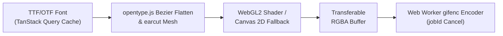

<p align="center">
  <h1 align="center">Typography Playground</h1>
  <p align="center">Browser-native Unicode text styler and WebGL2 / Web Worker kinetic typography studio</p>
  <p align="center"><a href="README.md">한국어</a> | <strong>English</strong> | <a href="https://typography-playground.seungwoo7050.workers.dev">typography-playground.seungwoo7050.workers.dev</a></p>
  <p align="center">Next.js 16 | React 19 | TypeScript | Tailwind CSS 4 | opentype.js | WebGL2 | Web Worker | Cloudflare Workers</p>
</p>

<p align="center"></p>

Two typography tools in one zero-backend static web app. Features a Unicode text style generator for copy-paste social bios and a real-time kinetic typography studio that renders animated glyph shaders and exports crisp PNGs or GIFs. The animated banner above combines four GIFs exported directly from the studio.

## Highlights

| Page | Description |
| --- | --- |
| **Unicode Generator** (`/`) | Type Latin text to convert into 18 Unicode styles (Bold, Italic, Script, Gothic, Double-Struck, Bubble, Square, Fullwidth, Small Caps, Superscript/Subscript, Strikethrough, Underline, Zalgo). One click copies plain text directly to the clipboard for social profiles and messaging apps |
| **Kinetic Typography** (`/kinetic`) | Type custom text, select from 40 Latin and Korean Google Fonts, customize shader effects (Gradient Fill, Outline Stroke, Glitch, Liquid Wave) via real-time sliders, and export high-resolution PNG snapshots or looping animated GIFs |

- **Client-only**: Font parsing, shader rendering, and GIF encoding run entirely in the browser with no backend, accounts, or analytics.
- **Self-hosted fonts**: All font binaries and license notices (SIL OFL) are bundled under `public/fonts/` for fast, offline loading.
- Respects system Reduced Motion settings. CSS transitions are disabled globally, and magnetic and parallax hooks automatically disable frame loops when reduced motion is preferred ([`reduced-motion.ts`](src/lib/motion/reduced-motion.ts)).

<p align="center"></p>

<p align="center"></p>

<p align="center"></p>

## Architecture & Technical Decisions



- **Codepoint offset math and exception tables**: Contiguous Mathematical Alphanumeric blocks (`U+1D400` and above) are transformed by adding the alphabet index to the block base codepoint, while historic BMP holes (`ℎ`, `ℯ`, `ℚ`, `ℤ`), Small Caps, and superscripts/subscripts live in immutable exception tables.
- **WebGL2 / Canvas 2D dual rendering**: Quadratic and cubic Bezier curves from `opentype.js` are flattened, classified into outer contours and inner holes by signed area, and triangulated with `earcut` ([`glyph-outline.ts`](src/features/kinetic-engine/core/glyph-outline.ts)). Shader effects (Liquid Wave, Glitch, Gradient Fill, Outline Stroke) run in WebGL2 and automatically fall back to a matching Canvas 2D renderer when WebGL2 is unavailable or `webglcontextlost` fires ([`render-loop.ts`](src/features/kinetic-engine/core/render-loop.ts), [`Canvas.tsx`](src/features/kinetic-engine/components/Canvas.tsx)).
- **Explicit `disposeGL` teardown**: Each effect implements `disposeGL` to free WebGL buffers, VAOs, and shader programs before swapping state, and temporary export WebGL contexts are released immediately via `WEBGL_lose_context`.
- **Web Worker GIF encoding with `Transferable` buffers**: Palette quantization (`rgba4444`, `oneBitAlpha`) and LZW compression run in a dedicated Web Worker so the 60fps preview never stutters ([`gif-encode.worker.ts`](src/features/kinetic-engine/export/worker/gif-encode.worker.ts)). Frame RGBA buffers transfer ownership via `postMessage(req, [rgbaBuffer])`, and a monotonic `jobId` discards stale worker jobs ([`gif-export.ts`](src/features/kinetic-engine/export/gif-export.ts)).
- **TanStack Query font caching**: Lightweight `woff2` files back CSS previews while raw `ttf`/`otf` binaries feed `opentype.js` outline extraction on demand, deduplicating concurrent requests ([`font-loader.ts`](src/features/kinetic-engine/core/font-loader.ts)).
- **Zustand state management**: A single store coordinates text, font selection, shader parameters, and async font loading lifecycle outside the component render loop ([`useKineticStore.ts`](src/features/kinetic-engine/store/useKineticStore.ts), [`KineticPlayground.tsx`](src/features/kinetic-engine/components/KineticPlayground.tsx)).

## Project Structure

- **Static Frontend**: Built with **Next.js 16** static export (`output: "export"`, `images.unoptimized`), **React 19**, and **Tailwind CSS 4** with no server runtime.

```text
src/app/                         pages (/, /kinetic) and layout
src/features/unicode-generator/  style mapping data, transforms, preview cards
src/features/kinetic-engine/     font loading, glyph triangulation, shaders, store, PNG/GIF export
public/fonts/                    bundled font binaries and licenses
scripts/                         font fetching scripts (fetch-fonts, fetch-kinetic-fonts)
tests/e2e/                       Playwright desktop and mobile E2E tests
docs/assets/                     README screenshots (excluded from deploy)
```

## Local Development & Validation

Requires Node `24.21.0` and npm `11.19.0` (`.nvmrc`, `package.json` engines).

```bash
npm ci
npm run dev                    # http://localhost:3100
npm run lint && npm run typecheck && npm run test
npm run test:e2e:production    # test production static export with Playwright
```

The CI pipeline runs linter, TypeScript check, unit test suite, static build, and Playwright E2E tests on every PR and push to `main`. On green, the `out/` directory deploys to Cloudflare Workers static assets (`wrangler.toml`), followed by a live smoke test.

## Scope & Limitations

- The 18 mathematical and stylistic Unicode transforms apply to Latin letters and ASCII digits; Korean and CJK scripts only change under combining mark styles (strikethrough, underline, Zalgo) and fullwidth spacing.
- Because `opentype.js` does not decompress WOFF2, both lightweight WOFF2 files (for CSS previews) and raw TTF/OTF binaries (for glyph outline extraction) are hosted and fetched on demand.
- While palette quantization and LZW encoding run in a Web Worker, the 30-frame synchronous capture loop runs on the main thread, and GIF output is fixed at 800×280, 15fps, and 2 seconds.

