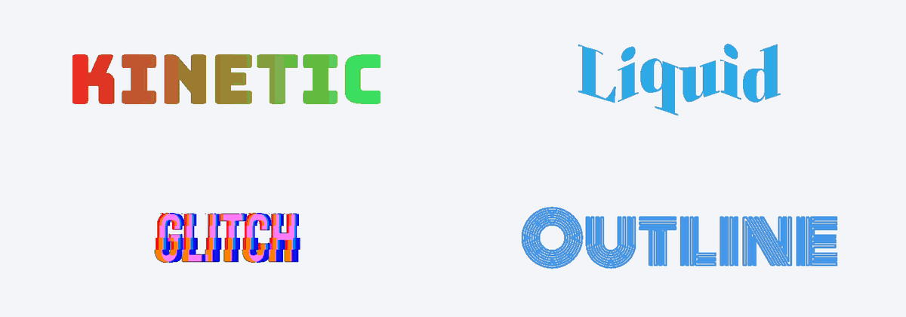
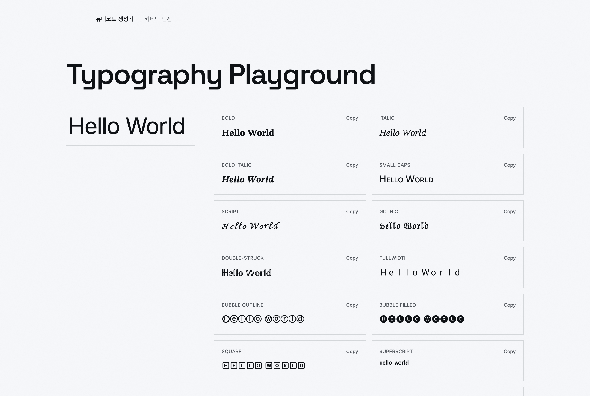
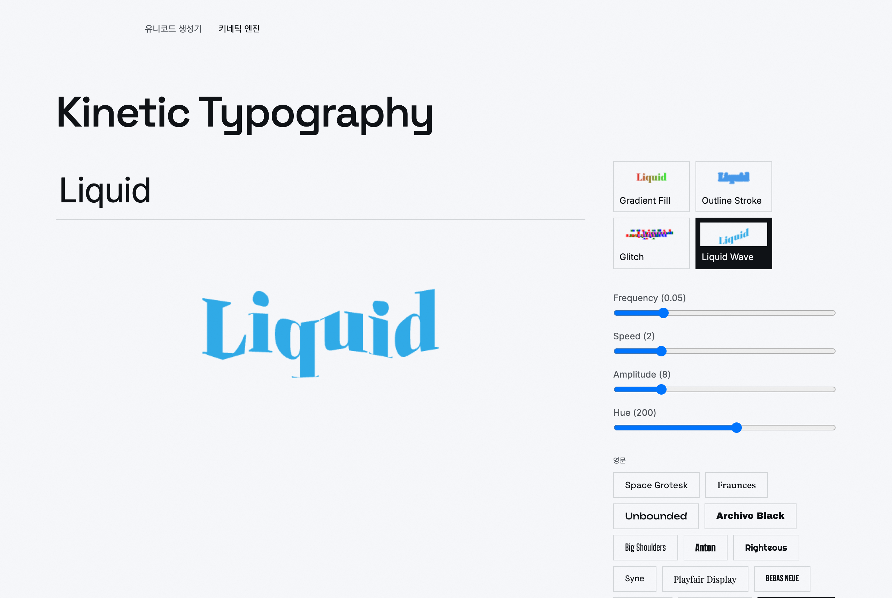
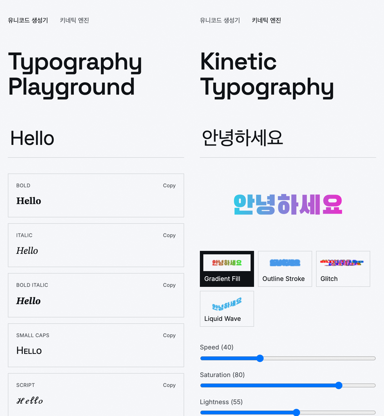

# Typography Playground

[한국어](README.md) · **English**

<p align="center"></p>

<p align="center">
  Next.js 16 · React 19 · TypeScript · Tailwind CSS 4 · opentype.js · WebGL2 · Web Worker · Cloudflare Workers<br>
  Jul – Oct 2026 · 87 commits · ~130 tests
</p>

Two small type tools in one static site: a Unicode text styler you can paste anywhere, and a kinetic typography canvas that renders animated lettering and exports it as PNG or GIF. The GIF above is four outputs of the app's own GIF export, tiled together.

**Live:** https://typography-playground.seungwoo7050.workers.dev

## What it does

| Page                                | What you do                                                                                                                                                                                                                                                                         |
| ----------------------------------- | ----------------------------------------------------------------------------------------------------------------------------------------------------------------------------------------------------------------------------------------------------------------------------------- |
| **Unicode generator** (`/`)         | Type Latin text and get it in 18 Unicode styles (Bold, Italic, Script, Gothic, Double-Struck, Bubble, Square, Fullwidth, Small Caps, Superscript/Subscript, Strikethrough, Underline, Zalgo). Copy any card with one click — it is plain text, so it works in social bios and chats |
| **Kinetic typography** (`/kinetic`) | Type a word, pick one of 41 fonts (Latin and Korean), choose an effect (Gradient Fill, Outline Stroke, Glitch, Liquid Wave), tune its parameters, and export a PNG still or an animated GIF                                                                                         |

- **No backend, no account, no tracking.** Everything runs in the browser.
- **Fonts are self-hosted** from the Google Fonts catalog (SIL OFL). Each font ships with its license in `public/fonts/`.
- Reduce Motion is respected. CSS transitions are switched off by one global media query, and the magnetic and parallax effects — which set transforms every frame — read the setting through a hook that also follows changes while the page is open ([`reduced-motion.ts`](src/lib/motion/reduced-motion.ts)).

<p align="center"></p>

<p align="center"></p>

<p align="center"></p>

## Run it

Requires Node `24.21.0` and npm `11.19.0` (`.nvmrc`, `package.json` `engines`).

```bash
npm ci
npm run dev                    # http://localhost:3100
npm run lint && npm run typecheck && npm run test
npm run test:e2e:production    # build, serve out/, run Playwright (desktop and mobile)
```

CI runs lint → typecheck → unit tests → build → e2e on every pull request and `main` push. When everything passes, `main`'s `out/` is deployed as Cloudflare Workers static assets (`wrangler.toml`), followed by a smoke test against the live URL.

## How it's built

- **Next.js 16** static export (`output: "export"`, `images.unoptimized`), **React 19**, **Tailwind CSS 4**. No server runtime.

```
src/app/                         pages (/, /kinetic) and layout
src/features/unicode-generator/  style data, transform, cards
src/features/kinetic-engine/     font loading, glyph outlines, effects, PNG/GIF export
public/fonts/                    self-hosted fonts and their licenses
scripts/                         font download scripts (fetch-fonts, fetch-kinetic-fonts)
tests/e2e/                       Playwright tests
docs/assets/                     README images (not deployed)
```
