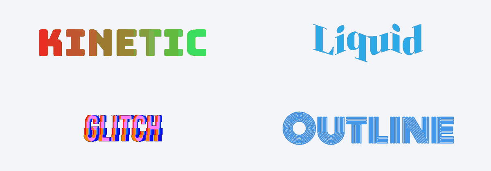
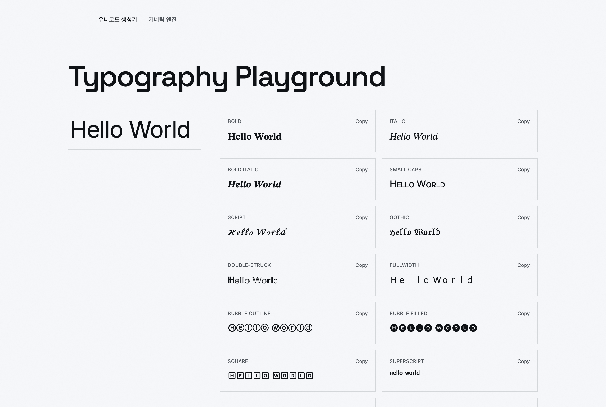

# Typography Playground

**한국어** · [English](README.en.md)

<p align="center"></p>

<p align="center">
  Next.js 16 · React 19 · TypeScript · Tailwind CSS 4 · opentype.js · WebGL2 · Web Worker · Cloudflare Workers<br>
  2026.07 – 2026.10 · 커밋 87개 · 테스트 약 130개
</p>

정적 사이트 하나에 담은 작은 타이포그래피 도구 두 개입니다. 어디에나 붙여 넣을 수 있는 유니코드 텍스트 꾸미기 도구와, 움직이는 글자를 그려 PNG나 GIF로 내보내는 키네틱 타이포그래피 캔버스입니다. 위 GIF는 앱의 GIF 내보내기로 만든 결과물 네 개를 이어 붙인 것입니다.

**서비스 주소:** https://typography-playground.seungwoo7050.workers.dev

## 하는 일

| 페이지                               | 하는 일                                                                                                                                                                                                                                                                        |
| ------------------------------------ | ------------------------------------------------------------------------------------------------------------------------------------------------------------------------------------------------------------------------------------------------------------------------------ |
| **유니코드 생성기** (`/`)            | 라틴 문자를 입력하면 18가지 유니코드 스타일(Bold, Italic, Script, Gothic, Double-Struck, Bubble, Square, Fullwidth, Small Caps, 위첨자/아래첨자, 취소선, 밑줄, Zalgo)로 바꿔 보여 줍니다. 카드를 누르면 바로 복사됩니다. 일반 텍스트라서 SNS 소개란이나 채팅에 그대로 붙습니다 |
| **키네틱 타이포그래피** (`/kinetic`) | 단어를 입력하고 폰트 41종(라틴·한글) 중 하나와 효과(Gradient Fill, Outline Stroke, Glitch, Liquid Wave)를 골라 파라미터를 조절한 뒤, PNG 정지 이미지나 움직이는 GIF로 내보냅니다                                                                                               |

- **백엔드, 계정, 추적이 없습니다.** 모든 처리는 브라우저에서 합니다.
- **폰트는 직접 호스팅합니다.** Google Fonts 카탈로그(SIL OFL)에서 받았고, 폰트마다 라이선스 파일이 `public/fonts/`에 함께 있습니다.
- 동작 줄이기 설정을 따릅니다. CSS 전환은 전역 미디어 쿼리 하나로 끄고, 매 프레임 transform을 바꾸는 마그네틱·패럴랙스 효과는 훅으로 시스템 설정 변경까지 따라갑니다([`reduced-motion.ts`](src/lib/motion/reduced-motion.ts)).

<p align="center"></p>

<p align="center"></p>

<p align="center"></p>

## 실행

Node `24.21.0`, npm `11.19.0`이 필요합니다(`.nvmrc`, `package.json`의 `engines`).

```bash
npm ci
npm run dev                    # http://localhost:3100
npm run lint && npm run typecheck && npm run test
npm run test:e2e:production    # 빌드한 out/을 띄워 Playwright 실행(데스크톱·모바일)
```

CI는 모든 pull request와 `main` push에서 린트 → 타입 검사 → 단위 테스트 → 빌드 → e2e를 돌립니다. 모두 통과하면 `main`의 `out/`을 Cloudflare Workers 정적 자산으로 배포하고(`wrangler.toml`), 배포한 주소에 스모크 테스트를 한 번 더 돌립니다.

## 구성

- **Next.js 16** 정적 export(`output: "export"`, `images.unoptimized`), **React 19**, **Tailwind CSS 4**. 서버 런타임이 없습니다.

```
src/app/                         페이지(/, /kinetic)와 레이아웃
src/features/unicode-generator/  스타일 데이터, 변환, 카드
src/features/kinetic-engine/     폰트 로딩, 글리프 윤곽선, 효과, PNG/GIF 내보내기
public/fonts/                    직접 호스팅하는 폰트와 라이선스
scripts/                         폰트 내려받기 스크립트(fetch-fonts, fetch-kinetic-fonts)
tests/e2e/                       Playwright 테스트
docs/assets/                     README 이미지(배포에 포함되지 않음)
```
