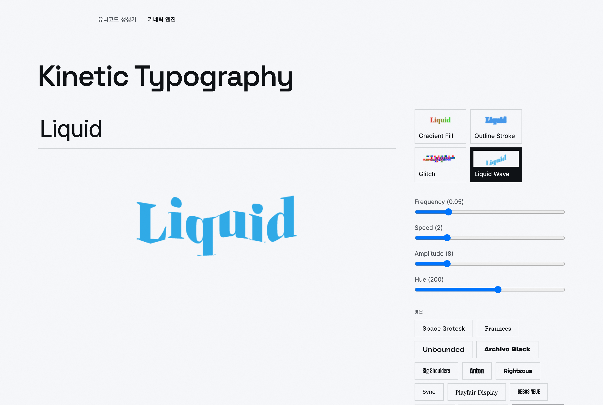
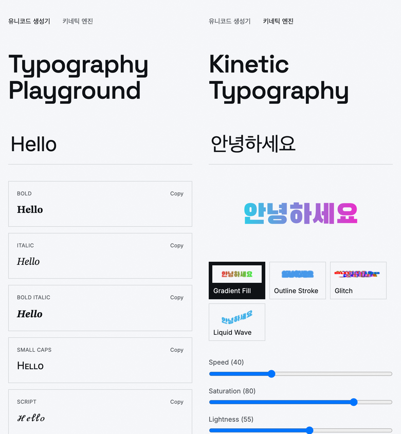
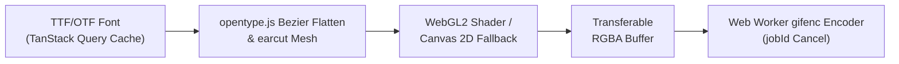

<p align="center">
  <h1 align="center">Typography Playground</h1>
  <p align="center">브라우저 기반 유니코드 스타일 변환기 및 WebGL2/Web Worker 키네틱 타이포그래피 스튜디오</p>
  <p align="center"><strong>한국어</strong> | <a href="README.en.md">English</a> | <a href="https://typography-playground.seungwoo7050.workers.dev">typography-playground.seungwoo7050.workers.dev</a></p>
  <p align="center">Next.js 16 | React 19 | TypeScript | Tailwind CSS 4 | opentype.js | WebGL2 | Web Worker | Cloudflare Workers</p>
</p>

<p align="center"></p>

정적 사이트 하나에 담은 타이포그래피 도구 두 개입니다. 어디에나 붙여 넣을 수 있는 유니코드 텍스트 스타일 변환기와, 움직이는 글자를 실시간으로 그려 PNG나 GIF로 내보내는 키네틱 타이포그래피 스튜디오로 구성되어 있습니다. 위 GIF는 앱의 GIF 내보내기 기능으로 생성한 결과물 네 개를 이어 붙인 것입니다.

## 주요 기능

| 페이지 | 설명 |
| --- | --- |
| **유니코드 생성기** (`/`) | 라틴 문자를 입력하면 18가지 유니코드 스타일(Bold, Italic, Script, Gothic, Double-Struck, Bubble, Square, Fullwidth, Small Caps, 위첨자/아래첨자, 취소선, 밑줄, Zalgo)로 즉시 변환해 보여 줍니다. 카드를 누르면 클립보드에 바로 복사되며, 일반 텍스트라서 SNS 소개란이나 채팅창에 그대로 붙여 넣을 수 있습니다 |
| **키네틱 타이포그래피** (`/kinetic`) | 문구를 입력하고 40종의 라틴 및 한글 폰트 중 하나와 셰이더 효과(Gradient Fill, Outline Stroke, Glitch, Liquid Wave)를 골라 파라미터를 조절한 뒤, 고해상도 PNG 정지 이미지나 애니메이션 GIF로 내보냅니다 |

- **무서버 로컬 실행**: 백엔드 서버, 계정, 사용자 추적 없이 폰트 파싱부터 셰이더 렌더링, GIF 인코딩까지 모든 처리를 브라우저 안에서 수행합니다.
- **자체 호스팅 폰트**: Google Fonts 카탈로그(SIL OFL)에서 내려받은 폰트 바이너리와 라이선스 전문을 `public/fonts/`에 포함했습니다.
- **동작 줄이기(Reduced Motion) 지원**: CSS 전환은 전역 미디어 쿼리로 비활성화하고, 매 프레임 transform을 갱신하는 마그네틱 및 패럴랙스 효과는 전용 훅으로 시스템 설정 변경을 실시간 반영합니다([`reduced-motion.ts`](src/lib/motion/reduced-motion.ts)).

<p align="center"></p>

<p align="center"></p>

<p align="center"></p>

## 설계와 기술적 선택



- **유니코드 오프셋 계산 및 예외 테이블 분리**: 연속 배치된 유니코드 수학 알파벳 블록(`U+1D400` 등)은 시작 코드포인트에 알파벳 오프셋을 더하는 수식으로 변환하고, 기본 다국어 평면(BMP)에 흩어져 있는 예외 글자(`ℎ`, `ℯ`, `ℚ`, `ℤ` 등)와 Small Caps, 위첨자/아래첨자만 별도 불변 테이블로 분리했습니다.
- **WebGL2 및 Canvas 2D 이중 렌더러**: `opentype.js`로 꺼낸 2차 및 3차 베지어 곡선을 지정 정밀도로 평탄화(Flatten)하고 Signed Area로 외곽선과 내부 홀(Hole)을 분류한 뒤 `earcut`으로 삼각 메쉬를 만듭니다([`glyph-outline.ts`](src/features/kinetic-engine/core/glyph-outline.ts)). 셰이더 효과(Liquid Wave, Glitch, Gradient Fill, Outline Stroke)는 WebGL2로 그리되, WebGL2 미지원 환경이나 `webglcontextlost` 발생 시 같은 입력을 받는 Canvas 2D 렌더러로 자동 전환합니다([`render-loop.ts`](src/features/kinetic-engine/core/render-loop.ts), [`Canvas.tsx`](src/features/kinetic-engine/components/Canvas.tsx)).
- **`disposeGL` 리소스 해제 훅**: 글자를 입력할 때마다 새 아웃라인의 WebGL 버퍼, VAO, 셰이더 프로그램이 GPU에 쌓이지 않도록 이펙트 인터페이스에 `disposeGL` 훅을 두고, 상태 교체 직전에 이전 리소스를 명시적으로 해제합니다. 내보내기용 임시 WebGL 컨텍스트는 직후 `WEBGL_lose_context`로 반납합니다.
- **Web Worker GIF 인코딩과 `Transferable` 버퍼**: 메인 스레드의 60fps 미리보기가 멈추지 않도록 팔레트 양자화(`rgba4444`, `oneBitAlpha`)와 LZW 압축을 전용 Web Worker로 분리했습니다([`gif-encode.worker.ts`](src/features/kinetic-engine/export/worker/gif-encode.worker.ts)). 프레임 버퍼는 복사하지 않고 `postMessage(req, [rgbaBuffer])`로 소유권만 이전하며 단조 증가 `jobId`로 이전 인코딩 작업을 취소합니다([`gif-export.ts`](src/features/kinetic-engine/export/gif-export.ts)).
- **TanStack Query 폰트 요청 병합 및 캐시**: 화면 미리보기용 경량 `woff2`와 `opentype.js` 윤곽선 파싱용 원본 `ttf`/`otf`를 나누어 호스팅하고, 선택한 폰트만 지연 로드하며 동시 요청을 하나로 합칩니다([`font-loader.ts`](src/features/kinetic-engine/core/font-loader.ts)).
- **Zustand 스토어 기반 상태 통합**: 텍스트, 폰트 선택, 이펙트 파라미터와 로딩 수명주기를 스토어 하나로 묶어 컴포넌트 렌더 루프 밖에서 비동기 폰트 교체 경쟁 상태를 제어합니다([`useKineticStore.ts`](src/features/kinetic-engine/store/useKineticStore.ts), [`KineticPlayground.tsx`](src/features/kinetic-engine/components/KineticPlayground.tsx)).

## 프로젝트 구성

- **프론트엔드 및 정적 빌드**: **Next.js 16** 정적 export(`output: "export"`, `images.unoptimized`), **React 19**, **Tailwind CSS 4**로 구성되어 서버 런타임 없이 동작합니다.

```text
src/app/                         페이지(/, /kinetic)와 레이아웃
src/features/unicode-generator/  유니코드 스타일 매핑 데이터, 변환 로직, 프리뷰 카드
src/features/kinetic-engine/     폰트 로딩, 글리프 윤곽선 분할, 셰이더 효과, 상태 스토어, PNG/GIF 내보내기
public/fonts/                    직접 호스팅하는 폰트 바이너리와 라이선스
scripts/                         폰트 내려받기 스크립트 (fetch-fonts, fetch-kinetic-fonts)
tests/e2e/                       Playwright 데스크톱 및 모바일 E2E 테스트
docs/assets/                     README 캡처 이미지 (배포 산출물에서 제외)
```

## 로컬 실행 및 검증

Node `24.21.0`, npm `11.19.0` 환경이 필요합니다(`.nvmrc`, `package.json`의 `engines`).

```bash
npm ci
npm run dev                    # http://localhost:3100
npm run lint && npm run typecheck && npm run test
npm run test:e2e:production    # 정적 빌드 산출물(out/)을 띄워 Playwright 실행 (데스크톱 및 모바일)
```

CI 파이프라인은 모든 Pull Request와 `main` 브랜치 push에서 린트, 타입 검사, 단위 테스트, 정적 빌드, Playwright E2E 테스트를 순서대로 실행합니다. 모든 검사를 통과하면 `main` 브랜치의 `out/` 디렉터리를 Cloudflare Workers 정적 자산으로 배포하고(`wrangler.toml`), 배포된 라이브 주소에 대해 스모크 테스트를 한 번 더 실행합니다.

## 범위와 한계

- 유니코드 수학 알파벳 블록 규격에 따라 18종 스타일 변환은 라틴 알파벳과 숫자를 대상으로 하며, 한글과 한자는 결합 문자(취소선, 밑줄, Zalgo)와 전각 공백 외에는 모양이 바뀌지 않습니다.
- `opentype.js`가 WOFF2 압축을 풀지 못해 화면 미리보기용 WOFF2와 윤곽선 추출용 TTF/OTF 원본을 따로 호스팅하며, 실제 다운로드는 사용자가 해당 폰트를 고를 때만 일어납니다.
- 팔레트 양자화와 LZW 인코딩은 Web Worker로 분리했지만, 30프레임 픽셀을 그리는 캡처 루프는 메인 스레드에서 실행되며 GIF 출력은 800×280 해상도, 15fps, 2초 길이로 고정되어 있습니다.

